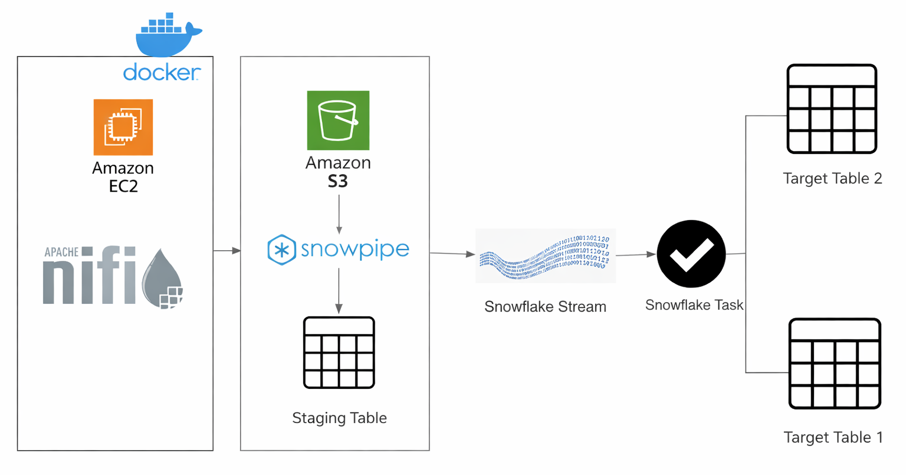
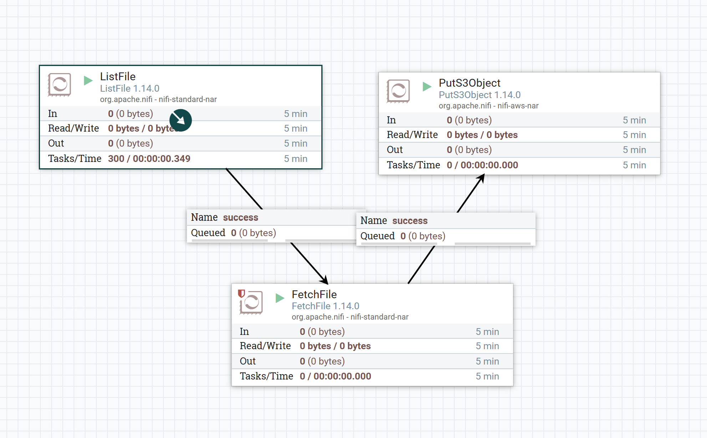

# Automated Data Ingestion Pipeline | Snowflake, Apache NiFi & AWS
## Introduction
Built an **automated data ingestion pipeline** using **Python, Apache NiFi, Amazon S3, and Snowflake**.
The pipeline generates synthetic customer data, transfers CSV files to Amazon S3 through Apache NiFi, and ingests them into Snowflake using **Snowpipe**. It also establishes the foundation for **Slowly Changing Dimensions (SCD Type 1 and Type 2)**.

## Architecture Diagram
**Data Flow**: Python → Apache NiFi → Amazon S3 → Snowflake External Stage → Snowpipe → CUSTOMER_RAW

The diagram also illustrates planned downstream processing using **Snowflake Streams and Tasks**.

## Technologies Used

### 1. Python and Faker

Generated synthetic customer CSV files containing **10,000 records each**, using timestamp-based filenames for repeated ingestion.

### 2. AWS EC2 and Docker

Deployed JupyterLab, Apache NiFi, and ZooKeeper using **Docker Compose** on an **AWS EC2 t2.large instance** running Amazon Linux 2023. Configured **shared Docker volumes** for cross-container file access.

### 3. Apache NiFi

Built an ingestion workflow using three processors:

- **ListFile**: Detects new CSV files.

- **FetchFile**: Retrieves file contents.

- **PutS3Object**: Uploads files to Amazon S3.
  

**Apache NiFi Workflow — CSV File Ingestion**: Screenshot showing a CSV file being processed through the NiFi workflow and transferred to Amazon S3.

### 4. Amazon S3

Used as the **intermediate storage layer** between Apache NiFi and Snowflake.

**S3 Location**: s3://snowflake-project-bucket-urmi/stream_data

### 5. Snowflake

Configured Snowflake as the **cloud data warehouse**, using an **external stage and Snowpipe** to automate CSV ingestion from Amazon S3 into the CUSTOMER_RAW table.

Created customer and history tables along with a **Snowflake Stream** to prepare for downstream **SCD Type 1 and Type 2 processing**.

Validated the ingestion pipeline by querying **50,000 customer records successfully loaded** into **Snowflake's CUSTOMER_RAW table**.

## Challenges Faced

- Container Compatibility: Resolved Docker startup issues, including **ZooKeeper image compatibility**, on AWS EC2.

- **Cross-Container Data Access**: Configured **shared Docker volumes** for seamless file access between JupyterLab and Apache NiFi.

- Cloud Data Integration: Connected **Apache NiFi, Amazon S3, and Snowflake** to automate ingestion into the data warehouse.

## Key Learnings

- Strengthened my understanding of **containerized data pipeline architecture** and service integration.

- Gained practical experience orchestrating file movement using **Apache NiFi**.

- Learned how **Snowflake external stages** and **Snowpipe** enable automated ingestion from Amazon S3.

- Explored **Snowflake Streams and SCD concepts** for downstream data processing.

## Future Improvements

- **SCD Type 1:** Update customer records without preserving historical values.

- **SCD Type 2:** Maintain historical customer records using effective timestamps.

- **Snowflake Tasks:** Automate downstream transformations and change processing.

## Project Status

**Completed:** Python data generation, Docker environment, NiFi ingestion, Amazon S3 integration, Snowpipe configuration, Snowflake tables, and initial Stream setup.

**Pending:** SCD Type 1/2 transformations and Snowflake Tasks.
